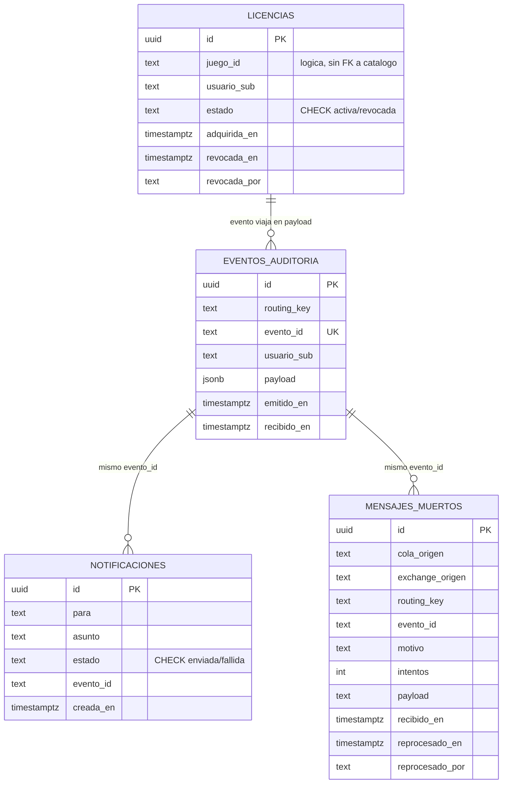

# Modelo de datos

Una sola instancia Postgres, con **un esquema por dueño de datos** para que la
propiedad quede explícita y no haya escrituras cruzadas.

| Esquema    | Dueño                  | Tablas                                          |
| ---------- | ---------------------- | ----------------------------------------------- |
| `licencias`| `vidalstore-biblioteca`| `licencias`                                     |
| `eventos`  | `vidalstore-eventos`   | `eventos_auditoria`, `notificaciones`, `mensajes_muertos` |

## Diagrama entidad-relación

Frontera entre los dos dueños: `licencias` es de `vidalstore-biblioteca`; las
otras tres son de `vidalstore-eventos`. No hay claves foráneas entre dueños: lo
que un consumidor necesita de una licencia viaja en el `payload` del evento, y
la relación entre `licencias.juego_id` y el catálogo es lógica (el catálogo lo
escribe otro servicio).

## `licencias.licencias`

| Columna       | Tipo          | Notas                                             |
| ------------- | ------------- | ------------------------------------------------- |
| `id`          | `uuid`        | PK                                                |
| `juego_id`    | `text`        |                                                   |
| `usuario_sub` | `text`        | `sub` del token                                   |
| `estado`      | `text`        | `activa` \| `revocada` (CHECK)                    |
| `adquirida_en`| `timestamptz` |                                                   |
| `revocada_en` | `timestamptz` | nulo mientras está activa                         |
| `revocada_por`| `text`        | nulo mientras está activa                         |

Restricciones:

- `UNIQUE (usuario_sub, juego_id) WHERE estado = 'activa'`: un usuario no puede
  tener dos licencias activas del mismo juego; puede recomprar tras una
  revocación.
- Índice por `usuario_sub` para la biblioteca del usuario.
- `CHECK` sobre `estado`.

## `eventos.eventos_auditoria`

Registro de todo evento que entra por la cola `auditoria`.

- `evento_id` es `UNIQUE`: la idempotencia se apoya en esa restricción. Si el
  evento llega dos veces, el `INSERT` falla con código `23505` y el consumidor
  hace `ack` sin duplicar.

## `eventos.notificaciones`

Correos "enviados" (simulados) a partir de `correo.enviar`.

- `id`, `para`, `asunto`, `estado` (`enviada`/`fallida`), `eventoId`, `creadaEn`.
- `UNIQUE (evento_id, asunto)`: la identidad de un aviso. Al reprocesar un
  mensaje muerto, el evento original se republica con su mismo `x-evento-id`, así
  que el aviso se recalcula igual y la inserción choca con este índice: el
  consumidor de correos detecta el conflicto, hace `ack` y no duplica el aviso.

## `eventos.mensajes_muertos`

Mensajes que terminaron en alguna DLQ.

- `cola_origen`, `routing_key`, `motivo`, `intentos`, `payload` (texto),
  `recibido_en`.
- `exchange_origen`: el exchange original, tomado de `x-death`. Necesario para
  republicar en el reproceso (4.9).
- `evento_id`: el `x-evento-id` del mensaje original. Si venía roto, se genera
  un UUID en el primer reproceso y se guarda aquí; los reprocesos siguientes
  reutilizan ese identificador.
- `reprocesado_en`, `reprocesado_por`: cuándo y quién pidió el reproceso (4.9).

El consumidor de mensajes muertos lee la cabecera `x-death` que RabbitMQ adjunta
al mensaje.
